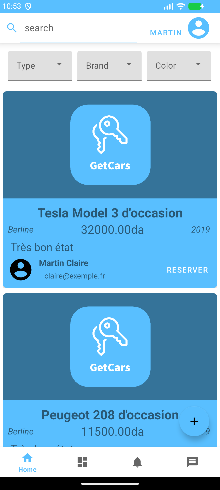
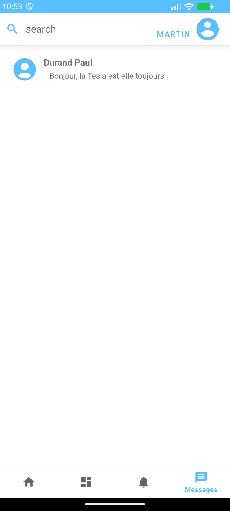

<p align="center"></p>

# GetCars — vente et location de véhicules

Mini-projet de fin de cycle de Licence : une application Android pour publier des annonces de véhicules, les parcourir sans compte, réserver une location ou demander un rendez-vous, et discuter en temps réel avec le vendeur. Elle parle à un serveur Express / TypeScript / MySQL.

<p align="center">
  
  
  
</p>

## Fonctionnalités

- Annonces : publier, modifier, supprimer, filtrer (type, marque, couleur…), rechercher par mots, photos
- Comptes : inscription, connexion par e-mail ou téléphone, profil, avatar, rôle administrateur
- Réservations (du … au …) et rendez-vous : le client les demande, le vendeur les accepte ou les refuse
- Messagerie en temps réel (Socket.IO) entre acheteur et vendeur
- Carte (TomTom) pour situer un rendez-vous

## Architecture

```
app/      Application Android (Java, Volley, Socket.IO client, TomTom)
server/   API REST + Socket.IO (Express 4, TypeScript, mysql2, zod)
  db/schema.sql   le schéma MySQL (idempotent)
  src/            config, auth, routes, temps réel
  test/           75 tests sur une vraie base MySQL
```

L'application parle à l'API en `POST` avec des formulaires (c'est ce que fait Volley) ; les erreurs « métier » (champ manquant, identifiants invalides, e-mail déjà pris…) restent des réponses HTTP 200 `{ "error": "…" }`. Ce qui touche à la sécurité a son vrai code : 401, 403, 429, 413.

## Lancer le serveur

Prérequis : Docker.

```bash
docker compose up --build        # MySQL + serveur sur http://localhost:5000
curl localhost:5000/health       # {"status":"ok"}
```

Sans Docker : `cd server && cp .env.example .env && npm ci && npm run db:schema && npm run dev` (Node 22, MySQL 8 ; voir `.env.example`).

Donner le rôle administrateur à un compte (créé d'abord depuis l'application) :

```bash
cd server && npm run promote-admin -- adresse@exemple.fr
```

### Production

Le serveur **refuse de démarrer** en `NODE_ENV=production` sans `JWT_SECRET` (32 caractères au moins, `openssl rand -base64 48`), avec un `DB_PASSWORD` vide ou celui du développement, ou avec `DB_USER=root`. Derrière un reverse proxy, mettre `TRUST_PROXY=true`. Les images déposées sont dans le volume `/data/images`.

## Lancer l'application

Ouvrir le dossier dans Android Studio (JDK 17), ou en ligne de commande :

```bash
./gradlew :app:assembleDebug     # app/build/outputs/apk/debug/app-debug.apk
```

Deux réglages, dans `local.properties` (non versionné) ou en `-P` :

| Réglage | Défaut | Rôle |
|---|---|---|
| `serverUrl` | `http://10.0.2.2:5000` | adresse du serveur (`10.0.2.2` : la machine hôte, vue depuis l'émulateur) |
| `tomtomKey` | vide | clé de l'API TomTom ; sans elle, tout fonctionne sauf la carte |

```properties
serverUrl=http://192.168.1.20:5000
tomtomKey=ma-cle
```

Le trafic en clair (HTTP) n'est autorisé que par le build debug ; une version release exige HTTPS.

## Tests

```bash
docker compose -f docker-compose.test.yml up -d --wait   # MySQL de test, port 33306
cd server && npm test                                     # 75 tests
```

Ils couvrent la configuration, l'authentification, les autorisations (qui peut lire, modifier, supprimer quoi), les tentatives d'injection SQL, l'envoi d'images piégées (traversée de répertoire, faux formats, taille) et la messagerie temps réel. La CI (GitHub Actions) les rejoue avec un service MySQL, construit l'image Docker et compile l'application Android.

## Ce qui a changé

La première version du projet fonctionnait mais n'était pas sûre. La réécriture du serveur corrige :

| Avant | Maintenant |
|---|---|
| Requêtes SQL construites par concaténation (injection possible sur la connexion, la recherche, les conversations, les filtres) | Requêtes paramétrées ; tables et colonnes cherchables sur liste blanche |
| Aucune authentification : n'importe qui lisait, modifiait ou supprimait les données d'un autre | Jetons JWT ; le vendeur, le client et l'administrateur ne touchent qu'à ce qui les concerne |
| Mots de passe en clair dans la base | argon2id ; même réponse et même durée pour un compte inconnu ou un mauvais mot de passe |
| Images écrites au chemin envoyé par le client | Noms fermés, format vérifié sur les premiers octets, taille limitée |
| Identité Socket.IO annoncée par le client (`init`) | Identité tirée du jeton ; expéditeur d'un message toujours celui du jeton ; débit limité |
| Pas de limite de tentatives | Limiteur sur la connexion (échecs), l'inscription et le total |
| Serveur lancé avec `root` et sans mot de passe ; clé TomTom et adresse IP dans le dépôt | Configuration validée au démarrage ; clé et adresse hors du dépôt |
| Pas de schéma SQL, pas de tests, pas de CI | `db/schema.sql`, 75 tests, CI, Docker |

> **Clé TomTom.** L'ancienne clé a été commitée : elle reste dans l'historique git. Elle doit être **révoquée** sur le portail TomTom et remplacée par une nouvelle (`tomtomKey`).

### Règles d'accès

| Ressource | Lecture | Écriture |
|---|---|---|
| Annonces | tout le monde | le vendeur (ou un administrateur) |
| Profil | nom : tout le monde ; coordonnées : comptes connectés ; âge : le titulaire | le titulaire (ou un administrateur) |
| Réservations, rendez-vous | le client, le vendeur de l'annonce, un administrateur | le client change date et lieu, le vendeur change l'état (`Pending`, `Accepted`, `Rejected`) ; une demande naît toujours `Pending` |
| Messages | les deux participants | l'expéditeur, qui est toujours le titulaire du jeton |
| Images d'annonces | tout le monde | le vendeur |
| Avatars | comptes connectés | le titulaire |

## API

Toutes les routes sont en `POST`, sauf `GET /` et `GET /health`. Les routes marquées 🔒 demandent `Authorization: Bearer <jeton>` (rendu par `/signin` et `/signup`).

| Route | |
|---|---|
| `/signup`, `/signin` | créer un compte, se connecter |
| `/user`, 🔒 `/user/update`, 🔒 `/user/remove` | profil |
| `/annonce`, `/annonces`, `/annonces/user` | lire (filtre : `filterObj`, un JSON de colonne → valeur) |
| 🔒 `/annonce/add`, `/annonce/update`, `/annonce/remove` | gérer ses annonces |
| `/search` | `term`, `table` (`annonce`, ou `client` 🔒), `cols` |
| 🔒 `/reservation(s)`, `/reservation/add\|update\|remove` | réservations |
| 🔒 `/rendezvous`, `/rendezvous/all`, `/rendezvous/add\|update\|remove` | rendez-vous |
| 🔒 `/chats`, `/messages`, `/messages/add` | conversations |
| 🔒 `/upload/image`, `/download/image` | images (les avatars demandent un compte) |

Socket.IO : connexion avec `auth: { token }` ; l'application émet `message`, reçoit `message-sent` (accusé), `message` (reçu) et `message-error`.

## Licence

MIT — voir [LICENSE](LICENSE).
